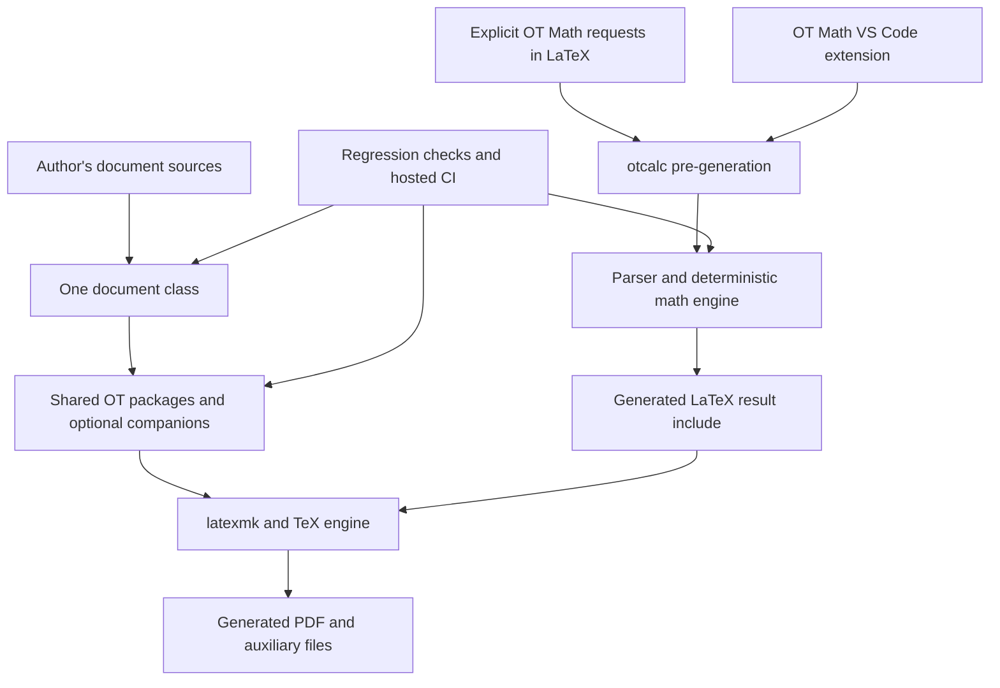

# Project Architecture — Chat-by-Chat Record

Prepared: **11 November 2026**. Dates use **Africa/Lagos** time.

Project root: `C:/Users/Ot/OneDrive/Documents/LaTeX/LaTeX-lab`

## Scope and evidence

This document explains the architecture, decisions, deliverables, and unfinished work recorded in the project's chats. Each chat has its own section, using its exact title from the chat inventory.

The inventory contains **10 relevant local Codex chats**: five explicitly assigned to the LaTeX-lab project and five whose working folder is LaTeX-lab. Both active and archived local history were queried; the archived query returned no chats. The separate ChatGPT project named `LaTeX` and chats assigned to other working folders are outside this inventory.

The account is based on paginated chat histories, with local existence checks for selected artifacts. **Historical test results, commits, and publication reports are records of what those chats reported, not fresh verification.** No LaTeX compilation, calculator test run, remote release inspection, or source-code repair was performed to create this document. Chat IDs provide traceability without inventing navigation URLs.

## Overall architecture

The chats describe three connected areas:

| Area | Responsibility | Main location |
| --- | --- | --- |
| LaTeX toolkit | Document classes, shared styling, author templates, regression checks, build and release workflow | `C:/Users/Ot/OneDrive/Documents/LaTeX/LaTeX-lab` |
| OT Math / OT Calculator | Deterministic calculation, parsing, result verification, CLI, VS Code integration, generated LaTeX results | `C:/Users/Ot/OneDrive/Documents/LaTeX/Ot-Calculator` |
| Authored documents and visual assets | Course notes, quizzes, personal books, manuals, branding, and portfolio experiments | Document projects, LaTeX-lab examples/output, and chat visualization folders |



The principal boundaries established across the chats are:

- **Styling and content:** LaTeX-lab maintains reusable classes and packages; independent books and course documents should have their own project folders.
- **Classes and packages:** a document chooses one class; reusable theme, box, notation, and infrastructure functionality belongs in packages.
- **Calculation and typesetting:** OT Math generates results before typesetting. Ordinary LaTeX compilation alone does not recompute calculator requests.
- **Editor integration and engine:** the VS Code extension invokes the local CLI; the Python engine owns mathematical operations.
- **Source and generated output:** source files, tests, and documentation are maintained separately from PDFs, logs, caches, and distributable archives.
- **Implementation and confidence:** a feature existing in source, compiling successfully, passing semantic checks, and receiving visual review are different levels of evidence.

## Chat index

Listed by the earliest substantive message in the retrieved history. Date ranges describe message dates, not the sidebar's last-updated time.

| # | Chat | Message dates | Architectural role |
| --- | --- | --- | --- |
| 1 | [Create phase contributions guide](#chat-1-create-phase-contributions-guide) | 9–16 August 2026 | Shared package architecture, modernization, author workflow, CI, performance, releases |
| 2 | [Create LaTeX style manual PDF](#chat-2-create-latex-style-manual-pdf) | 15 August 2026 | Author manual and source-reference guard |
| 3 | [Use LaTeX-lab for new projects](#chat-3-use-latex-lab-for-new-projects) | 20 August–9 September 2026 | Reuse model, native book class, templates, packaging, consolidated manual |
| 4 | [Suggest LaTeX repo imagery](#chat-4-suggest-latex-repo-imagery) | 20 August 2026 | Repository visual identity |
| 5 | [Ot-math solver](#chat-5-ot-math-solver) | 21 August–18 September 2026 | Separate calculation engine, CLI, LaTeX generation, VS Code extension |
| 6 | [Create PDF note and quiz](#chat-6-create-pdf-note-and-quiz) | 28–30 August 2026 | Practical notes and question-bank production |
| 7 | [Create graphic designer logo](#chat-7-create-graphic-designer-logo) | 29 August 2026 | Personal branding and portfolio media |
| 8 | [Calculate lower angular frequency](#chat-8-calculate-lower-angular-frequency) | 30 August 2026 | Worked mathematical explanation |
| 9 | [Find next improvements](#chat-9-find-next-improvements) | 4–11 November 2026 | Stabilization review and this architecture record |
| 10 | [Rebuild Rust book in LaTeX](#chat-10-rebuild-rust-book-in-latex) | 11 November 2026 | Proposed source-to-LaTeX book adaptation |

## Chat 1: Create phase contributions guide

**Chat ID:** `019fe45a-6ea4-76f0-931a-e213825a1ee5`  
**Association:** LaTeX-lab working folder.  
**Role:** the main development and governance history for Phases 5–10.

### Purpose and progression

The chat began with a visual explanation of upcoming phases while Phase 4 was mostly closed. It then became the working record for extracting shared styling, improving interfaces, creating author workflows, launching GitHub collaboration, measuring builds, and establishing release checks.

### Architectural decisions and implemented work

| Phase | Result | Architectural significance |
| --- | --- | --- |
| 5 — Shared design system | `ottheme.sty`, `otboxes.sty`, and `otcore.sty`; regression-harness fixes | Palette/hyperlink policy, reusable boxes, and common class setup moved into focused packages. |
| 6 — Conservative modernization | PhysicsQuiz capability markers, namespace guard, decimal marks validation, clearer author errors, starter bank, versioned-paper review | Improved contracts and diagnostics while preserving established author syntax. |
| 7 — Author workflow | Copyable starters, combined workbook starter, contributor guidance, issue/PR templates, packaging and release checklists | Turned the internal toolkit into a reusable author-facing system. |
| 8 — GitHub launch | Remote setup, starter CI, preview PDFs, source-derived author kit, branch-protection guidance and confirmation | Established collaboration and hosted build evidence. |
| 9 — Automation and performance | Timing reports, generated-file inventory, build-recipe checks, TikZ audit, optional image/PDF dot grid | Measured performance before changing rendering behavior. |
| 10 — Testing and releases | Version policy, release templates, local readiness guards, CI plan, release-source workflow, targeted-regression and release-candidate plans | Separated release preparation from publishing, version changes, and required-check promotion. |

Important implementation details:

- `otpractice` was changed to depend on shared boxes rather than requiring a class-owned box definition. Its standalone case became a positive passing test.
- `otengineering` retained its established `OTLight=#F3F4F6` palette difference during theme extraction.
- Shared packages adopted a LaTeX2e kernel floor of `2022-06-01`.
- The baseline checker gained a narrow date-normalization fallback for documents using today's date; this did not exempt arbitrary content changes.
- PowerShell log reads gained retries for transient Windows file locks.
- StudentNotes retained the TikZ dot-grid fallback, added `\setdotgridbackgroundimage{<path>}`, and made repeated `\usedotgrid` calls harmless.
- Hosted starter setup moved to standalone MiKTeX installation, tool-path discovery, download retries, and explicit installation of the package supplying `amsthm.sty`.

### Main artifacts

- [PROJECT_STATE.md](C:/Users/Ot/OneDrive/Documents/LaTeX/LaTeX-lab/PROJECT_STATE.md) and [CHANGELOG.md](C:/Users/Ot/OneDrive/Documents/LaTeX/LaTeX-lab/CHANGELOG.md).
- [PUBLIC_INTERFACES.md](C:/Users/Ot/OneDrive/Documents/LaTeX/LaTeX-lab/docs/PUBLIC_INTERFACES.md) and [AUTHOR_WORKFLOW.md](C:/Users/Ot/OneDrive/Documents/LaTeX/LaTeX-lab/docs/AUTHOR_WORKFLOW.md).
- [Phase checkpoints](<C:/Users/Ot/OneDrive/Documents/LaTeX/LaTeX-lab/docs/history/checkpoints/>). The chat used the older root-level locations; a later chat moved the checkpoint files here.
- [Starter build workflow](C:/Users/Ot/OneDrive/Documents/LaTeX/LaTeX-lab/.github/workflows/starter-build.yml) and [release-source workflow](C:/Users/Ot/OneDrive/Documents/LaTeX/LaTeX-lab/.github/workflows/release-source-checks.yml).
- [Targeted regression plan](C:/Users/Ot/OneDrive/Documents/LaTeX/LaTeX-lab/docs/TARGETED_REGRESSION_GATE_PLAN.md) and [release-candidate dry run](C:/Users/Ot/OneDrive/Documents/LaTeX/LaTeX-lab/docs/RELEASE_CANDIDATE_DRY_RUN.md).

### Recorded verification and unfinished work

The chat records accepted local regression runs and user-confirmed hosted starter builds. The Phase 9A measurement reported **15.75 seconds** for the measured incremental workload; it is a historical measurement, not a current performance guarantee.

By its final development checkpoint, implementation reached **10J**. `Starter documents` was the recorded required check; `Release source checks` was introduced as non-required. Repeated hosted success, possible promotion, targeted hosted regression implementation, and the first release-candidate rehearsal remained follow-up work. The `v0.1.0-rc-dry-run` label was a rehearsal label, not a created release tag. `l3build` was evaluated but not adopted as an active release gate.

## Chat 2: Create LaTeX style manual PDF

**Chat ID:** `01a004ee-37ac-7893-aa2e-a5cd75e6340f`  
**Association:** explicit LaTeX-lab project membership.  
**Role:** a source-derived reference for authors unfamiliar with the toolkit.

### Purpose and architecture

Created one workbook-style manual explaining the four classes then in scope—`physicsquiz`, `studentnotes`, `otscience`, and `otengineering`—and ten companion packages. The legacy `otscience.sty` was confined to a historical appendix.

The manual separates public author interfaces, shared/internal helpers, required dependencies, optional dependencies, and unresolved compatibility questions. Source line references connect usage examples to their implementation. A dedicated guard checks the presence of required sections and whether referenced source locations exist.

### Deliverables

- [Manual source](C:/Users/Ot/OneDrive/Documents/LaTeX/LaTeX-lab/examples/manual/ot_author_workbook_manual.tex).
- [Generated manual PDF](C:/Users/Ot/OneDrive/Documents/LaTeX/LaTeX-lab/build/manual/ot_author_workbook_manual.pdf).
- [Manual checkpoint](C:/Users/Ot/OneDrive/Documents/LaTeX/LaTeX-lab/docs/AUTHOR_WORKBOOK_MANUAL_CHECKPOINT.md).
- [Source-reference guard](C:/Users/Ot/OneDrive/Documents/LaTeX/LaTeX-lab/tests/run_manual_author_reference_guard.ps1).

### Recorded verification and unfinished work

The chat reported a **38-page PDF**, **399 checked source references**, zero guard warnings, and passing Phase 9B/9C checks. It also reported numerous overfull/underfull table warnings; successful compilation did not establish flawless layout.

No existing class/package behavior was changed by this chat. The original scope predates `otbook` and later companions, so the historical completion claim does not prove coverage of every package now present. Refresh the inventory and source references when maintaining this manual.

## Chat 3: Use LaTeX-lab for new projects

**Chat ID:** `01a02067-1df4-7da2-a5ad-cd60bc386f7c`  
**Association:** explicit LaTeX-lab project membership.  
**Role:** reusable project structure and the native personal-book workflow.

### Purpose and architectural decisions

The chat established the practical reuse model: retain LaTeX-lab as the shared toolkit, preserve old projects until their contents are accounted for, and create a separate folder for each substantial new document.

It identified a genuine class boundary: `otscience` is article-based and does not supply native chapters. The solution was an additive `otbook` class based on LaTeX's `book`, supporting `\chapter`, `\frontmatter`, `\mainmatter`, and `\backmatter`.

The reusable project template points back to the shared toolkit through `.latexmkrc`, with PDFs under `build/pdf` and auxiliary files under `build/aux`. Chapter content remains separate from the root document.

### Implemented work

- Created the initial book class, starter, and smoke document, then pushed commit `9f4b3f6` on `codex/add-otbook-class`.
- Completed a later hygiene pass, including **61 checkpoint moves** and path updates in affected guards.
- Integrated `otbook` into the author workflow, starter inventory, public interfaces, and author-kit documentation.
- Added a copyable book template and a dedicated runner covering the starter, smoke document, and copied template.
- Added source-only author-kit generation, dirty-tree refusal by default, an explicit local-snapshot option, and optional ZIP output.
- Advanced `otbook` to v0.2 with dedication, chapter epigraph, and chapter-overview helpers; chapter-opening boxes became breakable.
- Created the consolidated manual covering LaTeX-lab, OT Book, and OT Calculator, then expanded it with formula-library and graphics workflows.

### Reuse contracts

| Mechanism | Meaning |
| --- | --- |
| `\input{...}` | Include the content of a source file. |
| Macro-only formula library | Define reusable fragments that can be inserted selectively. |
| `\label`, `\ref`, `\eqref` | Identify and link to material already included in the document; they do not retrieve arbitrary external content. |
| `\OTMathUse{<id>}` | Insert a generated calculator result by its identifier. |
| Standalone figure source and compiled figure PDF | Preserve editable graphics while allowing reuse without rebuilding a heavy diagram on every document compilation. |

### Main artifacts

- [otbook.cls](C:/Users/Ot/OneDrive/Documents/LaTeX/LaTeX-lab/src/classes/otbook.cls).
- [Personal-book starter](C:/Users/Ot/OneDrive/Documents/LaTeX/LaTeX-lab/examples/otbook/starter_personal_book.tex).
- [Book project template](C:/Users/Ot/OneDrive/Documents/LaTeX/LaTeX-lab/templates/otbook-project/README.md).
- [Book test runner](C:/Users/Ot/OneDrive/Documents/LaTeX/LaTeX-lab/tests/run_otbook_tests.ps1).
- [Author-kit generator](C:/Users/Ot/OneDrive/Documents/LaTeX/LaTeX-lab/scripts/new-author-kit.ps1) and [author-kit guard](C:/Users/Ot/OneDrive/Documents/LaTeX/LaTeX-lab/tests/run_author_kit_tests.ps1).
- [LaTeX-full_manual.md](C:/Users/Ot/OneDrive/Documents/LaTeX/LaTeX-lab/LaTeX-full_manual.md).

### Recorded verification and unfinished work

The template was reported to build both inside the repository and from a copied path containing spaces. The later v0.2 book suite reported no duplicate PDF destinations or overfull-box warnings. Earlier duplicate `page.i` warnings should therefore be read in their chronological context.

Much of the later integration work was described as **staged**, not committed or pushed. The initial pushed book commit does not establish that every later addition was published. Cleanup-command behavior was not fully verified in the template checkpoint.

The chat ended by proposing standalone figures, plots, circuits, and book numbering improvements. Later local implementations exist for several of these; the proposal list should not be reused as a current backlog without checking the files.

## Chat 4: Suggest LaTeX repo imagery

**Chat ID:** `01a02093-10d6-7731-980b-f3942d6abec1`  
**Association:** LaTeX-lab working folder.  
**Role:** repository branding, with no code dependency.

### Purpose and outputs

Explored visual concepts representing the toolkit, including source-to-PDF production, notes, quizzes, engineering notebooks, and vector workbooks. The user selected two concepts: **LaTeX Lab Bench** and **Vector Workbook Grid**.

Four generated images were recorded:

- `latex-lab-bench-01.png`
- `latex-lab-bench-02.png`
- `vector-workbook-grid-01.png`
- `vector-workbook-grid-02.png`

Their [asset directory](C:/Users/Ot/.codex/visualizations/2026/08/20/01a02093-10d6-7731-980b-f3942d6abec1/latex-repo-images/) exists at review time.

### Architectural significance and status

These are presentation assets rather than class/package functionality. The chat explicitly reported no repository modification. It suggested a preferred banner image but did not establish that a banner had been integrated into the README or a release.

## Chat 5: Ot-math solver

**Chat ID:** `01a0248e-6c6d-7240-9d8f-4301353745ff`  
**Association:** explicit LaTeX-lab project membership; implementation deliberately moved to the adjacent `Ot-Calculator` folder.  
**Role:** the computation subsystem and its authoring integrations.

### Purpose and component architecture

The goal was a local-first math solver that complements document authoring. Deterministic computation is authoritative; optional AI interpretation/explanation is a separate adapter boundary.

All paths in this component table are relative to `C:/Users/Ot/OneDrive/Documents/LaTeX/Ot-Calculator`.

| Component | Location | Responsibility |
| --- | --- | --- |
| Request/result contract | `src/otmath/models.py` | Structured operations, expressions, variables, assumptions, answers, warnings, metadata, and steps. |
| Engine parser | `src/otmath/parser.py` | Validate and translate engine input before mathematical execution. |
| LaTeX adapter | `src/otmath/latex_input.py` | Interpret supported LaTeX notation and normalize symbols. |
| Deterministic engine | `src/otmath/engine.py`, `src/otmath/domains/` | Dispatch mathematical operations and attach verification information. |
| CLI | `src/otcalc/cli.py` | Build requests, invoke the common engine, and expose text/JSON/LaTeX results. |
| Document pre-generation | `src/otcalc/latex_build.py` | Read explicit requests from documents and write generated result includes. |
| TeX integration | `integrations/latex/otmath.sty` | Request/result macros and presentation helpers. |
| VS Code extension | `extensions/vscode-otmath/` | Selection commands, diagnostics, result refresh, macro installation, and local CLI invocation. |
| Verification and examples | `tests/`, `examples/latex/`, `docs/` | Automated checks, stress documents, API contracts, installation and manual QA records. |

### Implemented capabilities recorded in the chat

- Core symbolic operations: solve, simplify, differentiate, integrate, expand, and factor.
- A shared `MathRequest` / `run_request` execution path used by the CLI.
- Structured result metadata, warnings, explanation steps, and operation-specific verification strategies.
- CLI output formats, predictable error handling, version/quiet options, and opt-in local JSONL history.
- Systems of equations, sums, products, limits, inequalities, numeric solving, descriptive statistics, and a starter unit-conversion vocabulary.
- Matrix determinant, inverse, transpose, RREF, shape, rank, trace, powers, conjugate/adjoint, eigenvalues/eigenvectors, diagonalization, solving, spaces, decompositions, norms, and condition numbers.
- LaTeX symbol normalization for Greek, subscripted, and styled variables; grouped functions; derivative notation; matrix input; and plus/minus branching.
- Styled generated result blocks and labeled multi-part matrix results.
- VS Code selection operations, operation picker, diagnostics, setup checking, and bundled LaTeX macros.

These are historical implementation claims with scope limits; the final review below qualifies the parser and advanced-operation coverage.

### Document-generation contract

```text
Author writes explicit OT Math requests in a .tex document
    -> otcalc latex-build reads those requests
    -> parser and deterministic engine calculate results
    -> generated LaTeX include stores named results
    -> document imports/uses those results
    -> TeX builds the PDF
```

Key interfaces include `\OTMathCompute`, `\OTMathExplain`, `\OTMathGeneratedInput`, and named result reuse. A plain TeX build does not execute the Python calculator. The generated include path must match the file the document actually reads; stale-path mismatches caused visible failures during development.

The editor design changed after shortcut conflicts: OT Math stopped claiming `Ctrl+Alt+B` and `Ctrl+Alt+V`, leaving those to LaTeX Workshop. Its save hook refreshes generated results without compiling. The chat later recorded user-confirmed save-refresh output, but that does not establish every editor/build timing scenario is covered.

### Packaging and ownership decisions

- The Python engine, CLI, TeX integration, and VS Code extension stayed together in the calculator repository because they share contracts and release dependencies.
- `integrations/latex/otmath.sty` remained the source of truth; the extension carries a synchronized convenience copy.
- The user chose **VSIX installation and GitHub prereleases** rather than Marketplace publication.
- Although the calculator has a separate local repository, the chat used the existing `AnatO-my/LaTeX-lab` GitHub remote and dedicated calculator branches. This document does not claim those histories were merged into the toolkit's `main`.
- The chat reported prereleases through **Beta 5**, with wheel, source archive, and VSIX artifacts. Availability was not rechecked for this document.

There are two different files named `otmath.sty`: the toolkit's math-style package and the calculator's integration macros. Treat their ownership and load paths explicitly; the shared filename does not make them interchangeable.

### Verification history and latest known limitations

The chat contains several successful milestones: initial manual PDF/editor QA, a Beta 5 report of **241 passing Python tests**, and a later parser-hardening report of **272 passing tests**.

**The latest completed review supersedes those as a description of the then-current working tree:** it reported **96 passes and 10 failures** in a fresh focused run after additional edits. It identified:

1. Nested determinant notation and multiple-integral notation could silently lose mathematical meaning.
2. Piecewise conversion existed but was rejected by the engine parser.
3. Factorial parsing produced incorrect translated input.
4. Definite-integral verification needed interval-singularity handling.
5. Assumption handling and test expectations were inconsistent.
6. The operation called SVD returned singular values rather than a full decomposition; newer least-squares and pseudoinverse work had outpaced the limitations guide.
7. Explanation tests and documentation no longer matched the implementation consistently.

The subsequent `proceed` turn failed, with no final completion report. These issues must therefore remain **unresolved in this chat record**, unless a later source review or another chat proves otherwise. Substitution checks also do not prove solution completeness, and deterministic recomputation is not an independent mathematical proof.

Primary handover references: [calculator architecture](C:/Users/Ot/OneDrive/Documents/LaTeX/Ot-Calculator/docs/architecture.md), [LaTeX integration](C:/Users/Ot/OneDrive/Documents/LaTeX/Ot-Calculator/docs/latex.md), and [known limitations](C:/Users/Ot/OneDrive/Documents/LaTeX/Ot-Calculator/docs/known-limitations.md).

## Chat 6: Create PDF note and quiz

**Chat ID:** `01a04721-8708-72e3-a4e0-2c4a72e02e20`  
**Association:** LaTeX-lab working folder.  
**Role:** practical application of the document classes to teaching material.

### Workflow and decisions

The chat transformed supplied optics and oscillation/wave material into editable notes and quiz sources. `studentnotes.cls` provided the notes presentation; `physicsquiz.cls` supplied structured question banks, output modes, seeded option shuffling, answer keys, and worked solutions.

It used source PDFs as reference material, with mathematical clarification and question adaptation rather than blindly copying answer keys. Later turns deliberately separated source editing from compilation when the user requested review before building.

### Recorded deliverables

All source files below are in [output/tex](C:/Users/Ot/OneDrive/Documents/LaTeX/LaTeX-lab/output/tex/); generated PDFs use the matching names in [output/pdf](C:/Users/Ot/OneDrive/Documents/LaTeX/LaTeX-lab/output/pdf/).

| Source basename | Recorded outcome |
| --- | --- |
| `optics_chapter34_student_notes.tex` | 10-page optics notes. |
| `optics_chapter34_quiz.tex` | 20-question, 9-page quiz. |
| `oscillations_waves_student_notes.tex` | 15-page notes with worked examples. |
| `oscillations_waves_quiz.tex` | 30-question versioned quiz with solutions. |
| `resonance_transients_waves_student_notes.tex` | Expanded notes, ultimately reported as 18 pages. |
| `phy104_vibrations_wave_phenomena_100_question_quiz.tex` | 100 questions; 30 foundation, 45 applied, 25 challenge; 22-page compiled output. |
| `phy104_calculation_only_100_question_bank.tex` | Separate 100-question numerical bank with worked solutions; 21-page compiled output. |

The expanded notes clarified transient versus driving frequency, phase versus group velocity, explicit/implicit dispersion differentiation, and exact versus approximate single-slit maxima conditions. The 100-question curriculum included vibrations/SHM and wave phenomena, with 70% of questions at applied or challenge difficulty.

### Verification and architectural significance

The chat records compilation, log inspection, source-structure checks, and visual review. All seven listed source files are present at review time; the three final expanded-note/100-question PDFs were also confirmed present.

The first optics task consulted the OT Calculator chat for context but explicitly did **not** invoke it. These documents demonstrate the authoring toolkit in use; they do not establish an automated calculator-to-question-bank pipeline. The chat reported leaving class files unchanged.

## Chat 7: Create graphic designer logo

**Chat ID:** `01a04d9f-645e-7803-b704-5ab29e79b00a`  
**Association:** explicit LaTeX-lab project membership.  
**Role:** a personal design/media side project stored in the same workspace.

### Work recorded

The chat generated a graphic-designer mark, Fiverr profile copy and tagline, several promotional-video variants, mockup imagery, and a six-page portfolio PDF. The logo concept combined a pen nib and cursor arrow in a charcoal/cyan/coral palette.

Video iterations progressed from a six-second introduction to 24-, 27-, and 28-second presentations, with the final described version including branding, print, and social-media mockups.

### Architecture and artifact status

No reusable LaTeX class, package, mathematical engine, or build-system change was established by this chat. Its role is content/media production, separate from the toolkit's maintained source architecture.

The historical root-level output paths included:

- `C:/Users/Ot/OneDrive/Documents/LaTeX/LaTeX-lab/graphic-designer-logo.png`
- `C:/Users/Ot/OneDrive/Documents/LaTeX/LaTeX-lab/graphic-designer-picture-promo-28s.mp4`
- `C:/Users/Ot/OneDrive/Documents/LaTeX/LaTeX-lab/graphic-designer-portfolio.pdf`

**These three paths were checked and are absent at review time.** The chat's delivery reports remain historical evidence; they are not working download links, and their absence here does not establish that all copies were deleted. The other video variants were not individually checked.

## Chat 8: Calculate lower angular frequency

**Chat ID:** `01a05391-0187-7161-94dd-e579cb647b30`  
**Association:** LaTeX-lab working folder.  
**Role:** an explanatory calculation, not an implementation change.

### Problem and result

For equal masses of 2 kg and stiffness matrix `K = [[10, -4], [-4, 10]]`, the chat explained the generalized eigenvalue relation `K phi = omega^2 M phi` with `M = 2I`.

The stiffness eigenvalues are 6 and 14, giving squared frequencies 3 and 7. The lower angular natural frequency is **sqrt(3), approximately 1.73 rad/s**, assuming consistent stiffness units.

### Architectural significance

This is a useful teaching example for the coupled-oscillator notes and a potential future calculator regression fixture. The retrieved chat records no code modification, generated document, engine invocation, or implemented test. Its relationship to OT Math is conceptual rather than a demonstrated integration.

## Chat 9: Find next improvements

**Chat ID:** `01a1a666-b2b3-7252-a372-8b878853e240`  
**Association:** explicit LaTeX-lab project membership.  
**Role:** review of the expanded toolkit and preparation of this architecture document.

### Review findings recorded on 4 November

The read-only review recommended a stabilization pass and identified:

| Finding | Affected area | Proposed improvement |
| --- | --- | --- |
| All four configured batch-build root documents were absent | `scripts/build-all.ps1` | Use actual document roots and report failures clearly. |
| Azimuth formulas used `atan(y/x)` | `src/packages/otcoordinates.sty` | Preserve quadrant information and document singular cases. |
| Hosted starter CI called the older seven-starter runner | `.github/workflows/starter-build.yml` | Add book coverage and selected newer semantic regression suites. |
| Future-upgrade lists included features already implemented locally | `LaTeX-full_manual.md`, project-state records | Reconcile implemented, tested, experimental, and planned capabilities. |
| Alternative-text helper discarded its text argument | `src/packages/otaccess.sty` | Complete the pilot and test resulting PDF structure. |

The recommendation was to begin with the batch-build repair and a reliable regression entry point. **No fixes or compilation were performed in that review.** These findings are dated observations, not a fresh validation of the entire working tree on 11 November.

### Current deliverable

The user's next request authorized this `PROJECT_ARCHITECTURE.md`: a record separated by chat. Creating it changes documentation only and does not implement the stabilization backlog above.

## Chat 10: Rebuild Rust book in LaTeX

**Chat ID:** `01a1cb90-84d2-7ab1-bf29-b2538f12b2b1`  
**Association:** LaTeX-lab working folder.  
**Role:** a proposed downstream book-adaptation project.

### User goal and proposed architecture

The user wanted an edition of *The Rust Programming Language* that supports convenient annotation and highlighting. The chat recommended using the book's structured upstream Markdown instead of reconstructing document semantics from PDF extraction.

The proposed flow was:

```text
Structured Markdown chapters and separate assets
    -> chapter-by-chapter conversion to LaTeX
    -> reusable book styling and native code listings
    -> selectable-text PDF with navigation and annotation space
    -> representative-page visual comparison and refinement
```

Pandoc conversion, a customized template, code listings, hyperlinks, generous margins, and a Unicode-capable engine were suggestions. PDF text extraction plus rendered visual references was the fallback for material available only as PDF.

### Status and integration boundary

This chat contains **guidance only**. It did not clone a repository, create LaTeX chapters, select a final template, or compile a book.

It is a prospective consumer of the `otbook` workflow. Any LuaLaTeX/XeLaTeX choice would need validation against the actual project packages; the suggestion does not expand LaTeX-lab's documented pdfLaTeX support claim. A small representative chapter would be the first concrete implementation and review unit.

## Cross-chat handover

### Relationships

- **Create phase contributions guide** supplies the shared packages, tests, starters, CI, and release framework used by the authoring chats.
- **Create LaTeX style manual PDF** documents the earlier class/package surface; **Use LaTeX-lab for new projects** adds the book workflow and a broader consolidated manual.
- **Ot-math solver** supplies optional computation to documents while retaining a separate local source tree and test/release lifecycle.
- **Create PDF note and quiz** demonstrates the toolkit with real teaching material; **Calculate lower angular frequency** provides a related explanatory example.
- **Suggest LaTeX repo imagery** and **Create graphic designer logo** produce visual assets with no established runtime role in the toolkit.
- **Find next improvements** identifies integration and reliability gaps; **Rebuild Rust book in LaTeX** proposes a future downstream use case.

### Open work supported by these histories

| Area | Evidence-backed next action |
| --- | --- |
| Toolkit build reliability | Recheck and repair batch-build targets, then establish an appropriate combined verification command. |
| Toolkit mathematics | Review coordinate-angle formulas and their domain conventions. |
| Regression coverage | Connect newer book/report/project/form coverage to the verification workflow after confirming each runner's scope. |
| Manuals and project state | Update inventories, source references, support claims, and obsolete future-feature lists. |
| Accessibility | Treat the current helper as a pilot until actual tags/alternative text are verified. |
| Calculator correctness | Reproduce the latest focused failures and resolve silent interpretation errors before extending syntax. |
| Release governance | Confirm actual branch, hosted checks, source commit, and intended product before tagging or publishing. |
| Rust book | Build and review a small source-derived chapter prototype. |

### Limits of this architecture record

The working tree also contains later companions and engineering/reporting work whose complete implementation provenance is not established by these ten chats. This document does not assign that work to a chat merely because it was mentioned in a review.

Historical messages sometimes used “complete,” “clean,” or “passed” for a particular checkpoint. Those claims apply to that checkpoint's source state. They do not override subsequent changes, later failures, or current file contents. Before continuing implementation, use the relevant chat section together with the current source and its focused checks.
